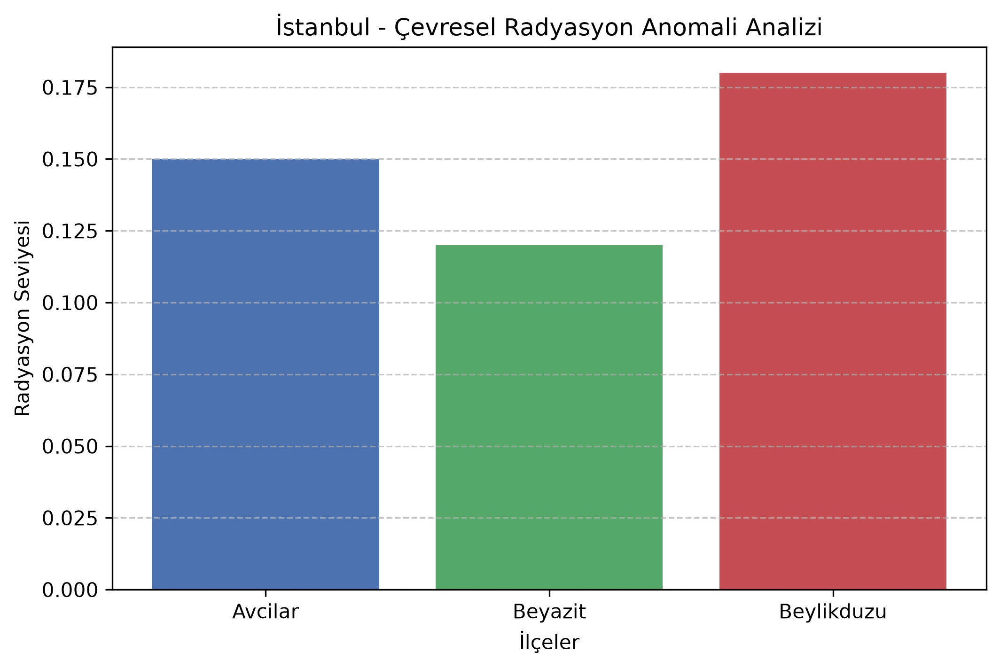

# Enviromental Radiation & GPS Anomaly Analysis 

## Overview 
This repository contains a Python-based data analysis project designed to process, filter, and visualize enviromental radiation data. As a physics student aiming to specialize in computational and data physics, I developed this tool to bridge the gap between theoretical laboratory 
measurements and real-world data science applications.

## Objectives
""Data Ingestion:"" Reading and structuring raw environmental data (Location, GPS coordinates, Radiation levels).
""Anomaly Detection:"" Filtering and identifying hazardous radiation anomalies using logical operators.
""Data Visualization:"" Generating professional, analytical bar charts for comparative geographical analysis.

## Tech Stack 
""Language:"" Python 3.x
""Libraries:""
    'Pandas' (Data manipulation, cleaning, and filtering)
    'Matplotlib' (Data visualization and graphical output)

  ## Result & Visualization
  The analysis ssystematically identifies geographical areas with elevated radiation levels. Below is the viasualized output of the processed dataset:

  

  ## How to run
  1. Clone this repository to your local machine.
  2. Install the required dependencies: 'pip install pandas matplotlib'
  3. Execute the analysis script: 'python main.py'

